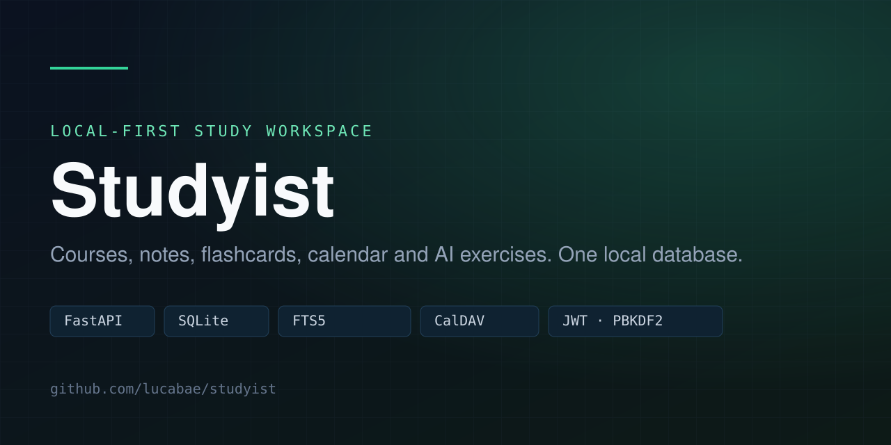
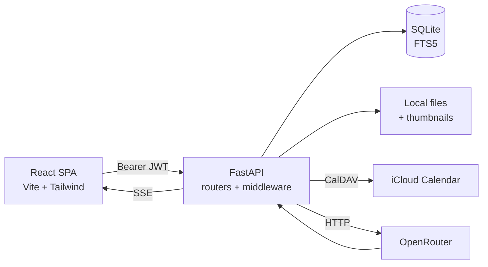
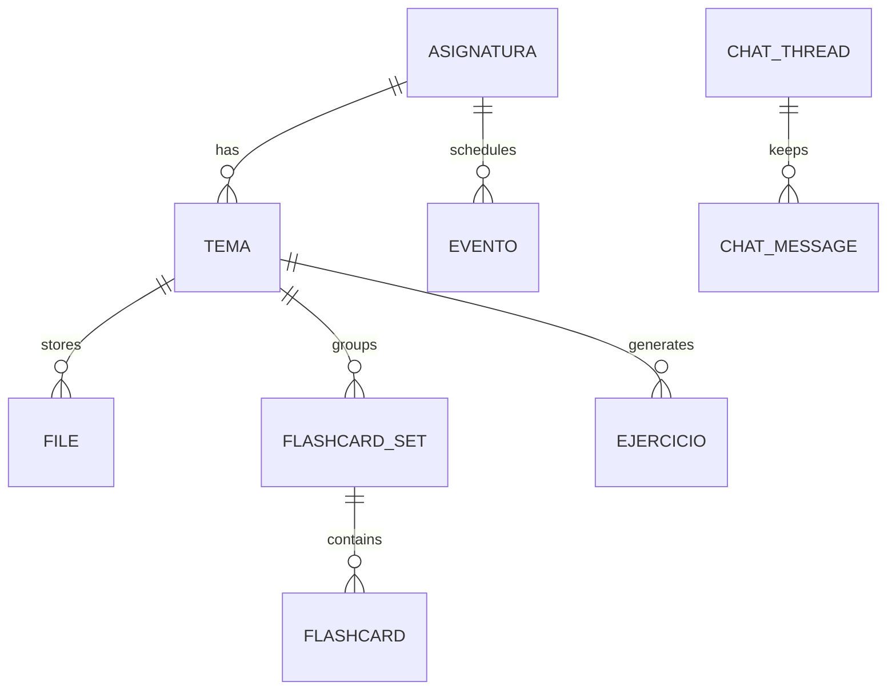

<div align="center">
  
</div>

# Studyist

A single-user, local-first workspace for university study: courses and topics, notes (PDF and images), calendar events synced over CalDAV, spaced-repetition flashcards, an AI chat, and generated programming exercises.

There is no sign-up and no multi-user logic. The app runs on your machine, is protected by one password, and is not meant to be exposed to the internet.

## What it does

- **Courses and topics** with a nested structure and per-topic file attachments.
- **Files**: PDFs and raster images up to 30 MB, thumbnails, and full-text search over PDF content with SQLite FTS5.
- **Calendar**: events (exams, tasks) linked to courses and topics, pushed one-way to iCloud with CalDAV and tracked by UID/ETag.
- **Flashcards**: hand-written sets or generated from a topic, with spaced repetition and review sessions.
- **AI**: chat with streaming responses, flashcard generation, and exercise generation through OpenRouter.
- **Exercises**: stored test cases with an optional sandboxed runner (disabled by default).
- **Auth**: one local password (PBKDF2-HMAC-SHA256, 600k iterations) and JWT access/refresh tokens.

## Screenshots

The interface is a React SPA: dashboard, courses, topics, files, flashcards, calendar and chat. Screenshots are not committed yet; run it locally with the steps below.

## Stack

| Layer | Technology |
|---|---|
| API | Python 3.11+, FastAPI, SQLAlchemy, Pydantic |
| Data | SQLite with FTS5 |
| Auth | PyJWT (HS256), PBKDF2 password hash, per-IP login rate limit |
| Integrations | CalDAV/iCloud, OpenRouter, pypdfium2, Pillow |
| Frontend | React 18, TypeScript, Vite, Tailwind CSS, CodeMirror |
| Tests | pytest (backend), `tsc --noEmit` (frontend) |

## Architecture



The backend listens on `127.0.0.1:8080`; the frontend dev server runs on `5173` and proxies API calls. Every route except login and refresh requires a Bearer token, including the `/files` mount.

## Data model



`FILE` is indexed into a virtual `file_fts` table by triggers, so search stays in sync on insert, update and delete.

## API

Routers: `/auth`, `/asignatura`, `/tema`, `/files`, `/evento`, `/flashcard`, `/flashcard_set`, `/chat`, `/openrouter`, `/ejercicio`, `/study`.

The generated OpenAPI document lives at `web/openapi.json`, and the TypeScript client is generated from it with `@hey-api/openapi-ts`. Interactive docs (`/docs`, `/redoc`) are disabled at runtime.

## Run it

Requirements: Python 3.11+, Node.js 20+, npm, Git, bash.

```bash
git clone https://github.com/lucabae/studyist.git
cd studyist

python3 -m venv server/venv
server/venv/bin/pip install -r server/requirements.txt

cd web && npm install && cd ..

./sh/db_init.sh        # creates db/db.sqlite3
cp .env.example .env   # then set JWT_SECRET
./sh/hash_password.sh  # writes server/auth/password.hash
./sh/start.sh          # backend + frontend
```

Open <http://localhost:5173> and log in with the password you just set.

Minimum environment:

| Variable | Required | Purpose |
|---|---|---|
| `JWT_SECRET` | Yes | Signs session tokens. Generate with `openssl rand -hex 32`. |
| `OPENROUTER_API_KEY` | No | Chat, flashcard and exercise generation. |
| `ICLOUD_MAIL` | No | iCloud account for CalDAV events. |
| `ICLOUD_APP_PASSWORD` | No | App-specific password. |
| `ICLOUD_CALENDAR_NAME` | No | Target calendar, default `Educación`. |

Without iCloud the events are still stored locally; they just are not pushed to the remote calendar.

## Tests

```bash
server/venv/bin/python -m pytest -q
cd web && npm run typecheck
```

The suite uses a temporary database and a stubbed OpenRouter client, so it neither touches your data nor spends credit. The real iCloud test is skipped by default.

## Security notes

- Single user, no TLS, bound to loopback only. Do not expose port 8080 directly.
- `.env`, `server/auth/password.hash` and `server/auth/device.json` are git-ignored.
- Access tokens last 2 days, refresh tokens 4 days, with rotation on refresh.
- Login is rate-limited to 10 failures per IP per 15 minutes.
- Uploads are validated by content, not extension; HTML and SVG are rejected.
- Exercise execution is disabled by default (`EXERCISE_RUN_ENABLED = False`).

## Structure

```
server/        FastAPI app: main, auth, views, scripts
db/            SQL schema and SQLAlchemy models
web/           React + TypeScript frontend
prompts/       Model prompts
sh/            Start, database init, password hashing, API client generation
tests/         pytest suite
PROJECT.md     Functional specification
```

## License

MIT. See [LICENSE](LICENSE).
